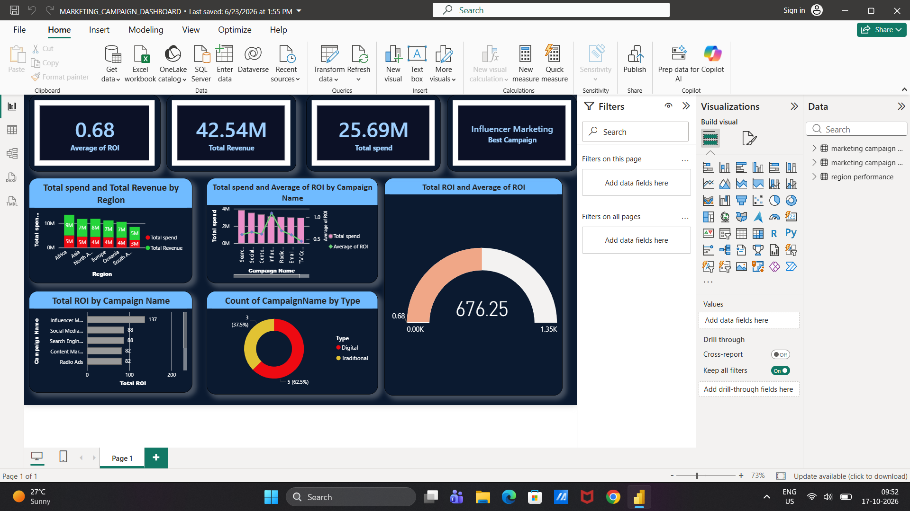

# 📊 Global Marketing Campaign Performance & ROI Analytics Dashboard (Power BI)

> **An end-to-end Power BI business intelligence solution evaluating $42.54M in revenue and $25.69M marketing spend across global regions and diverse marketing channels.**

---

## 📌 Executive Summary
This project analyzes cross-channel marketing performance across 1,000 campaigns in multiple global regions (North America, Europe, Asia, Africa, Oceania, South America). It evaluates budget allocation efficiency, channel conversion effectiveness, and net ROI attribution to guide strategic marketing investments.

### 🎯 Key Performance Indicators (KPIs)
* **Total Revenue Generated:** $42.54M
* **Total Marketing Spend:** $25.69M
* **Average Campaign ROI:** 0.68 (68% net return)
* **Top Performing Campaign:** Influencer Marketing (137 Total ROI)
* **Channel Mix:** 62.5% Digital (5 Channels) vs. 37.5% Traditional (3 Channels)

---

## 🖥️ Interactive Dashboard Preview

---

## 🏗️ Data Architecture & Modeling (Star Schema)
The data model is engineered using a Star Schema architecture to optimize DAX calculation performance and relationship filter flow:

* **Fact Table:** `marketing campaign performance` (1,000 campaign transactions tracking Spend, Impressions, Clicks, Conversions, Revenue, and ROI).
* **Dimension Tables:**
  * `marketing campaign details` (Channel metadata, category classification, average ROI).
  * `region performance` (Geographic spend and regional revenue performance).
* **Relationships:** 1-to-many cardinality with clean single-direction cross-filtering.

---

## 🔍 Core Business Insights
1. **Top Channel Efficiency:**
   * **Influencer Marketing** delivered the highest total ROI (137), making it the primary organic conversion engine.
   * **Digital Channels** (Social Media, Search Engine, Content, Email, Influencer) represent 62.5% of campaigns and maintain the highest click-to-conversion rates.
2. **Regional Spend vs. Revenue:**
   * **Africa & North America** generated the highest attributed revenues relative to allocated budget, proving high return on marketing spend.
3. **Traditional Channel Viability:**
   * While Traditional channels (TV Commercials, Billboards, Radio) have higher production costs, Radio Ads demonstrated strong regional engagement.

---

## 📁 Repository Structure
* `MARKETING_CAMPAIGN_DASHBOARD.pbix`: Complete interactive Power BI report file.
* `/Dataset`: Underlying transactional CSV datasets.
* `/Images`: Visual dashboards and data model schema previews.
* `dax-measures.md`: Custom DAX metrics and calculations.

---

## 🛠️ Tools & Technologies
* **Power BI Desktop:** Star Schema Data Modeling, KPI Cards, Donut Charts, Gauges, Combo Charts.
* **DAX (Data Analysis Expressions):** Dynamic aggregations, ratio analysis, and context filtering.
* **Data Transformation:** Data cleaning and standardization.

---
**Author:** Aditya Dev Tripathi  
*Data Analyst | Business Intelligence*
